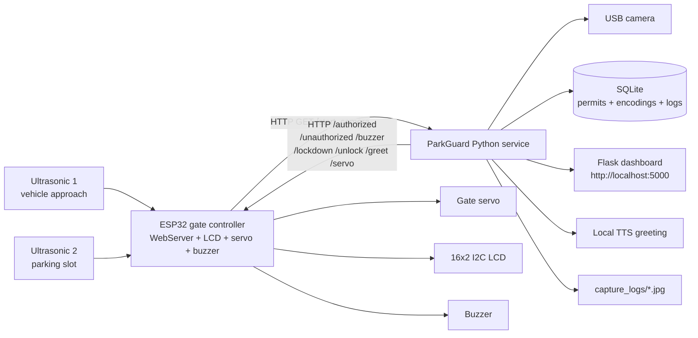

# ParkGuard

**Local-first smart parking gate with offline face recognition, SQLite permits, and an ESP32 hardware controller.**

ParkGuard runs entirely on a local machine. A USB camera stays in standby until
an ESP32 ultrasonic sensor detects an approaching vehicle. The Python service
then performs one bounded face-recognition scan, writes an audit event to
SQLite, and sends the decision back to the ESP32, which drives the gate servo,
LCD, and buzzer.

No cloud API, no external face service, and no biometric data leaves the host.

---

## Features

- **Trigger-driven camera** — the camera is closed in standby and opens only for
  one ESP32-triggered scan, reducing CPU/GPU load and camera wear.
- **Offline face recognition** — dlib/`face_recognition` models are loaded from
  local `.dat` files.
- **Permit validation** — four-digit permits: `1xxx` = resident/upper floor,
  `0xxx` = visitor/ground floor.
- **Stability gate** — a face must stay clear and visible for a configurable
  hold period before an event is logged.
- **Audit trail** — SQLite rows plus timestamped snapshot images in
  `capture_logs/`.
- **Cumulative security policy** — the first unauthorized attempt is logged;
  repeated attempts trigger the ESP32 buzzer and a lockdown state.
- **Arabic-first dashboard** — live status, weekly summary, day filters, permit
  details, and snapshot cards.
- **Hardware feedback** — I2C LCD, gate servo, occupancy sensor, and buzzer
  sequences on the ESP32.
- **Optional integrations** — local TTS greeting (`pyttsx3` or Windows SAPI) and
  an optional USB serial command channel.

---

## Architecture



### Event flow

1. The approach ultrasonic sensor detects a car (`<= 15 cm`).
2. The ESP32 calls `GET http://<server>:5000/start_camera`.
3. The Python trigger service opens the camera for one bounded session.
4. A clear face must remain visible for `PARKGUARD_STABILITY_SECONDS` (default
   `3.0` seconds).
5. The face is matched against local 128-D encodings and checked against the
   `permits` table.
6. An annotated snapshot and an `access_logs` row are written.
7. The ESP32 receives the decision:
   - authorized → check the parking sensor, open the servo, greet the user;
   - unauthorized → show a denial message;
   - repeated unauthorized → buzzer + lockdown.
8. The camera is released and the system returns to standby.

---

## Hardware

| Component | Suggested part | Purpose |
|---|---|---|
| Microcontroller | ESP32 DevKit v1 (30-pin) | Gate controller and Wi-Fi |
| Camera | USB webcam | Face capture |
| Distance sensors | 2 × HC-SR04 | Approach detection + parking occupancy |
| Actuator | SG90 or MG996R servo | Gate arm |
| Feedback | Passive buzzer | Full-garage and alarm sequences |
| Display | 16×2 I2C LCD, address `0x27` | Local status messages |
| Power | External 5 V supply | Servo and sensors (common ground with ESP32) |

### ESP32 wiring

| Function | ESP32 GPIO | Direction | Notes |
|---|---:|---|---|
| Approach ultrasonic TRIG | 13 | Output | Sensor #1, driveway |
| Approach ultrasonic ECHO | 32 | Input | Use a voltage divider for a 5 V HC-SR04 |
| Parking ultrasonic TRIG | 14 | Output | Sensor #2, parking slot |
| Parking ultrasonic ECHO | 25 | Input | Use a voltage divider for a 5 V HC-SR04 |
| Buzzer signal | 33 | Output | Passive buzzer; other lead to GND |
| Servo signal | 12 | Output | External 5 V for servo power; common GND |
| LCD SDA | 26 | I2C data | LCD backpack address `0x27` |
| LCD SCL | 27 | I2C clock | `Wire.begin(26, 27)` in firmware |

> **Power warning:** do not power a loaded servo from the ESP32 3.3 V pin. Use a
> separate 5 V supply and connect its ground to the ESP32 ground.
>
> **Boot note:** GPIO 12 is an ESP32 strapping pin. If the board has trouble
> booting with the servo connected, move `SERVO_PIN` to another free output and
> update the firmware constant.

See [`docs/WIRING.md`](docs/WIRING.md) for a more detailed wiring guide.

---

## Repository layout

```text
park_Ai/
├── main.py                     # Camera service, SQLite, Flask dashboard, ESP32 client
├── face_models.py              # Registers project-local dlib model files
├── esp32_comm.py               # Optional USB serial transport to the ESP32
├── add_user_db.py              # Add/update permits in SQLite
├── train_faces.py              # Build encodings.pickle + face_encodings table
├── firmware/
│   └── parkguard_esp32/
│       ├── parkguard_esp32.ino # Fully documented ESP32 firmware
│       └── secrets.example.h   # Copy to secrets.h (git-ignored)
├── scripts/
│   └── download_models.py      # Download the four dlib model files
├── docs/
│   └── WIRING.md               # Detailed hardware/wiring notes
├── tests/
│   └── test_main.py            # Self-contained behaviour tests
├── faces/
│   └── README.md               # Private dataset instructions (images ignored)
├── capture_logs/
│   └── .gitkeep                # Runtime snapshots (images ignored)
├── .env.example                # Configuration template
├── .gitignore
├── requirements.txt
└── README.md
```

---

## Getting started

### 1. Prerequisites

- Python **3.10+** (3.11/3.12 recommended for the widest dlib wheel support)
- A USB camera visible to OpenCV
- Arduino IDE 2.x with the **ESP32** board package
- ESP32 libraries:
  - **ESP32Servo** by Kevin Harrington / John K. Bennett
  - **LiquidCrystal_I2C** by Frank de Brabander
- Windows users may need **CMake** and **Visual Studio Build Tools** to build
  `dlib` if a prebuilt wheel is unavailable.

### 2. Clone and create a virtual environment

```bash
git clone <your-repository-url> park_Ai
cd park_Ai
python -m venv .venv
```

Activate it:

```powershell
# Windows PowerShell
.\.venv\Scripts\Activate.ps1
```

```bash
# macOS / Linux
source .venv/bin/activate
```

### 3. Install Python dependencies

```bash
python -m pip install --upgrade pip
pip install -r requirements.txt
```

### 4. Download the dlib models

The model files are **not committed** to Git because they are large
third-party binaries. Download them once:

```bash
python scripts/download_models.py
```

This writes four files next to `main.py`:

- `shape_predictor_68_face_landmarks.dat`
- `shape_predictor_5_face_landmarks.dat`
- `dlib_face_recognition_resnet_model_v1.dat`
- `mmod_human_face_detector.dat`

`main.py` checks for these files at startup and prints a clear error if any are
missing.

### 5. Configure the server

Copy the example environment file:

```powershell
# Windows PowerShell
Copy-Item .env.example .env
```

```bash
# macOS / Linux
cp .env.example .env
```

Edit `.env` and set the ESP32 LAN address:

```dotenv
PARKGUARD_ESP32_IP=192.0.2.10   # replace with your board's LAN IP
PARKGUARD_PORT=5000
```

Leaving `PARKGUARD_ESP32_IP` empty is valid: the camera/dashboard still work,
but gate signalling is disabled.

You can also configure everything with CLI flags or shell environment
variables. `PARKGUARD_ESP32_IP` is read at import time; use `--esp32-ip` to
override it for one run:

```bash
python main.py --esp32-ip 192.0.2.10
```

> Never commit `.env` or a real `secrets.h`. Both are git-ignored.

### 6. Flash the ESP32 firmware

1. Open `firmware/parkguard_esp32/parkguard_esp32.ino` in Arduino IDE.
2. Copy `secrets.example.h` to `secrets.h` in the same folder.
3. Fill in your Wi-Fi SSID/password and the **LAN IP of the computer running
   `main.py`** (not `localhost`).
4. Select **ESP32 Dev Module** and the correct serial port.
5. Upload and open the Serial Monitor at `115200` baud.
6. The LCD shows the ESP32's IP address after it joins Wi-Fi.

The firmware exposes every endpoint used by `main.py` and documents every pin
definition and hardware block in comments.

### 7. Enroll a person and a permit

Create a private dataset folder:

```text
faces/
└── alice/
    ├── photo-1.jpg
    └── photo-2.jpg
```

Add the matching permit record:

```bash
python add_user_db.py --owner alice --permit 1001 \
  --student-id 30000001 --display-name "Alice Example"
```

- `1001` → resident / upper floor
- `0456` → visitor / ground floor
- `--owner` must exactly match the `faces/<owner>/` folder name.
- The demo rows can be created with `python add_user_db.py --seed`.

Generate encodings:

```bash
python train_faces.py
```

If the database is empty, `main.py` also enrolls from `faces/` on first start.
To force a full rebuild:

```bash
python main.py --rebuild-encodings
```

### 8. Run the service

```bash
python main.py
```

Open the dashboard:

```text
http://localhost:5000
```

The camera stays in **STANDBY** until the ESP32 calls `/start_camera`. To test
without hardware, queue a scan manually:

```bash
curl -X POST http://localhost:5000/start_camera
```

Press `q` in the preview window to stop a scan; `Ctrl+C` in the terminal stops
the service.

---

## Configuration reference

`main.py` reads configuration from environment variables (and `.env` when
`python-dotenv` is installed). The most useful values are:

| Variable | Default | Description |
|---|---|---|
| `PARKGUARD_ESP32_IP` | *(empty)* | ESP32 LAN IP; empty disables HTTP signalling |
| `PARKGUARD_ESP32_TIMEOUT_SECONDS` | `1.5` | HTTP timeout for ESP32 calls |
| `PARKGUARD_SERIAL_PORT` | *(empty)* | Optional serial port, e.g. `COM5` |
| `PARKGUARD_HOST` | `0.0.0.0` | Dashboard bind address |
| `PARKGUARD_PORT` | `5000` | Dashboard/trigger port |
| `PARKGUARD_CAMERA_INDEX` | `0` | OpenCV camera index |
| `PARKGUARD_PREVIEW` | `1` | Show the OpenCV preview window |
| `PARKGUARD_FACE_TOLERANCE` | `0.45` | Lower is stricter |
| `PARKGUARD_STABILITY_SECONDS` | `3.0` | Required continuous clear visibility |
| `PARKGUARD_SCAN_TIMEOUT_SECONDS` | `10.0` | Maximum duration of one scan |
| `PARKGUARD_BUZZER_AFTER_ATTEMPTS` | `2` | Unauthorized streak that triggers buzzer/lockdown |
| `PARKGUARD_SERVO_OPEN_ANGLE` | `90` | Servo angle used for "open" |
| `PARKGUARD_TTS` | `1` | Enable local "Welcome" speech |
| `PARKGUARD_GREETING_SIGNALS` | `1` | Send greeting/servo HTTP signals |

See `.env.example` for the complete annotated list.

---

## HTTP API

### Python service

| Method | Path | Purpose |
|---|---|---|
| `GET`, `POST` | `/start_camera` | Queue one ESP32-triggered scan |
| `GET`, `POST` | `/trigger` | Alias for `/start_camera` |
| `GET`, `POST` | `/reset_security` | Clear unauthorized streak and lockdown |
| `GET` | `/api/status` | JSON system state |
| `GET` | `/health` | Liveness check |
| `GET` | `/capture_logs/<filename>` | Serve a snapshot |

### ESP32 endpoints

| Method | Path | Behaviour |
|---|---|---|
| `GET` | `/authorized` | Check parking sensor, open gate or show "Garage Full" |
| `GET` | `/unauthorized` | Show "Access Denied"; no buzzer |
| `GET` | `/buzzer` | Play the repeated-attempt alarm sequence |
| `GET` | `/lockdown` | Close gate and display lockdown |
| `GET` | `/unlock` | Clear lockdown and return to standby |
| `GET` | `/greet?name=Alice` | Show a welcome message |
| `GET` | `/servo?action=open` | Open gate if the slot is free |
| `GET` | `/servo?action=close` | Close the gate |
| `GET` | `/status` | JSON distances, gate, and lockdown state |

---

## Security policy

`process_access_event()` keeps a persisted unauthorized streak in SQLite:

- **First unauthorized attempt:** logged only.
- **Every attempt from `PARKGUARD_BUZZER_AFTER_ATTEMPTS` onward:** the ESP32
  buzzer sounds and `lockdown` is enabled.
- **Authorized scan or `/reset_security`:** clears the streak and unlocks the
  gate.
- The dashboard shows the current streak and lockdown status.
- The ESP32's `/unauthorized` endpoint deliberately does **not** buzz; the
  Python service calls `/buzzer` only when the policy allows it. This keeps the
  hardware consistent with the software policy.

ParkGuard is a local-network prototype. It does not provide HTTPS
authentication for its HTTP endpoints; do not expose port `5000` directly to the
public internet. Put it behind a firewall or a reverse proxy with authentication
if remote access is required.

---

## Tests

The test suite uses a temporary SQLite database and does not require real face
photos or downloaded dlib models:

```bash
python -m unittest discover -s tests -v
```

Covered areas include permit validation, encoding storage/matching, face
tracking, stability timing, dashboard reconciliation, ESP32 security signals,
scan queueing, and self-contained dataset enrollment.

---

## Privacy and repository hygiene

The following are intentionally **git-ignored**:

- `faces/` and `dataset_faces/` — biometric photographs
- `capture_logs/` — event snapshots
- `park_guard.db`, `encodings.pickle` — local biometric data and audit history
- `*.dat` — large third-party dlib models
- `.env`, `firmware/**/secrets.h` — local IPs and Wi-Fi credentials

Only commit the folder README files (`faces/README.md`,
`capture_logs/.gitkeep`) that explain the expected layout.

If this repository was copied from an existing local project, verify the
following before pushing:

1. No personal photos or student IDs are staged.
2. No real Wi-Fi passwords, API tokens, or IP addresses are staged.
3. Any token that was ever stored in a tracked file has been rotated or revoked.

---

## Troubleshooting

| Problem | Fix |
|---|---|
| `Missing dlib model file(s)` | Run `python scripts/download_models.py` |
| `dlib` fails to install on Windows | Install CMake + Visual Studio Build Tools, then `pip install dlib` |
| Camera opens but no face is matched | Add more clear photos, run `python train_faces.py`, check `PARKGUARD_FACE_TOLERANCE` |
| ESP32 cannot reach the server | Use the computer's LAN IP (not `localhost`), allow port `5000` through the firewall |
| LCD is blank | Check I2C address (`0x27` vs `0x3F`) and that SDA=26/SCL=27 match the firmware |
| Gate opens without a car | Check the parking ultrasonic wiring; the gate only opens when the slot reports free |
| `No face encodings were enrolled` | Ensure `faces/<owner>/` contains images and the owner matches `permits.car_owner` |
| Dashboard is empty | Confirm `PARKGUARD_CAPTURE_DIR` and `PARKGUARD_DB_PATH` point to the same files used by the service |

---

## العربية

**ParkGuard** نظام محلي بالكامل لبوابة مواقف ذكية:

- تستيقظ الكاميرا فقط عند إشارة المستشعر فوق الصوتي من ESP32.
- يتم التعرف على الوجه محلياً باستخدام dlib دون أي خدمة سحابية.
- التصريح يتكون من 4 أرقام: `1xxx` لساكن الطابق العلوي، `0xxx` لزائر الطابق الأرضي.
- تُحفظ السجلات والصور في SQLite ومجلد `capture_logs`.
- المحاولة غير المصرح بها الأولى تُسجل فقط، والمحاولات المتكررة تشغل البازر وتفعّل القفل.
- لوحة التحكم العربية تعمل على `http://localhost:5000`.

الإعداد السريع:

```bash
pip install -r requirements.txt
python scripts/download_models.py
python add_user_db.py --owner alice --permit 1001 \
  --student-id 30000001 --display-name "Alice Example"
python train_faces.py
python main.py
```

لا ترفع الصور الشخصية أو قاعدة البيانات أو ملفات `secrets.h` أو `.env` إلى GitHub؛
جميعها مستثناة في `.gitignore`.

---

## License

MIT License. See [`LICENSE`](LICENSE).
